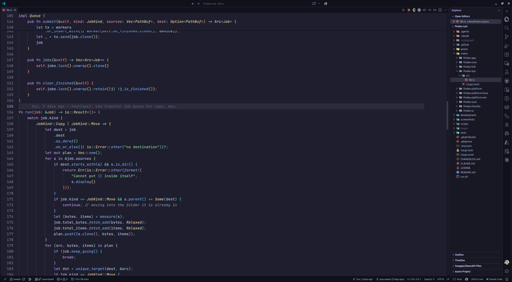

# VS Code Settings

My personal VS Code setup: Catppuccin Mocha with a clean, JetBrains Fleet-inspired layout.

## Look

- **Theme:** [Catppuccin Mocha](https://marketplace.visualstudio.com/items?itemName=Catppuccin.catppuccin-vsc)
- **Icons:** [Material Icon Theme](https://marketplace.visualstudio.com/items?itemName=PKief.material-icon-theme)
- **Font:** [JetBrains Mono](https://www.jetbrains.com/lp/mono/), size 18, ligatures on, line height 1.6

## Layout

- Sidebar on the right, with the activity bar beside it
- AI chat panel hidden on startup (`Ctrl+Alt+B` to open)
- Compact menu, command center in the title bar, no breadcrumbs
- Minimap that only appears on mouseover
- Thin scrollbars, compact tabs, extra editor padding
- Window title without the app name

## Speed

- Telemetry and experiments off
- No tips, walkthroughs or extension recommendations
- `node_modules`, `.git/objects`, `.venv` and `.gradle` excluded from the file watcher

## Files

| File | Purpose |
|---|---|
| `settings.json` | Main user settings |
| `keybindings.json` | Custom keybindings |
| `tasks.json` | User tasks |
| `green-theme.json` | Older settings variant |

## Use

Copy the files into your VS Code user folder:

- Linux: `~/.config/Code/User/`
- macOS: `~/Library/Application Support/Code/User/`
- Windows: `%APPDATA%\Code\User\`

Then install the Catppuccin and Material Icon Theme extensions and reload the window.
